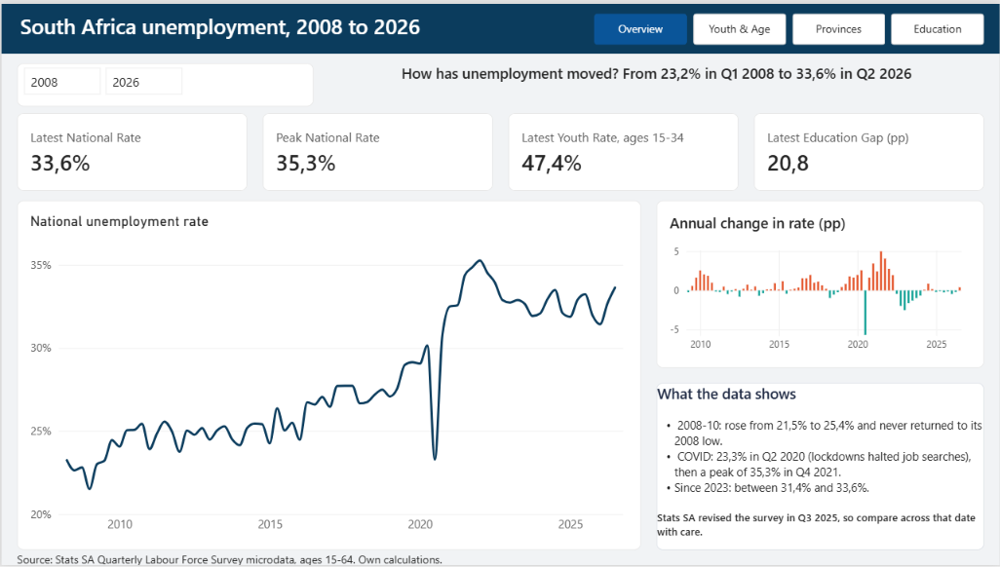
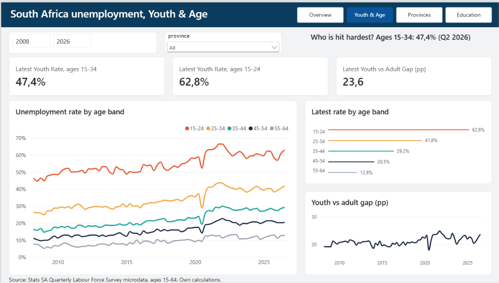
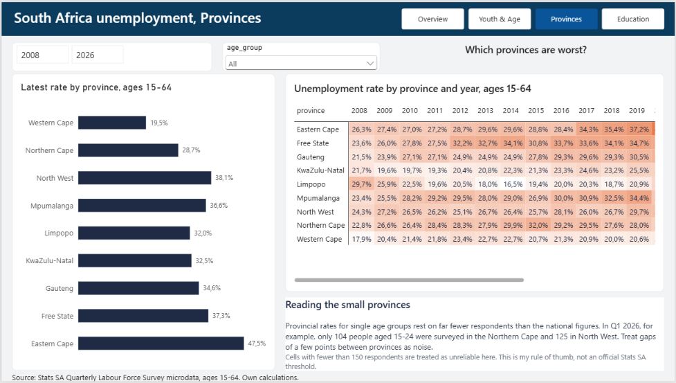
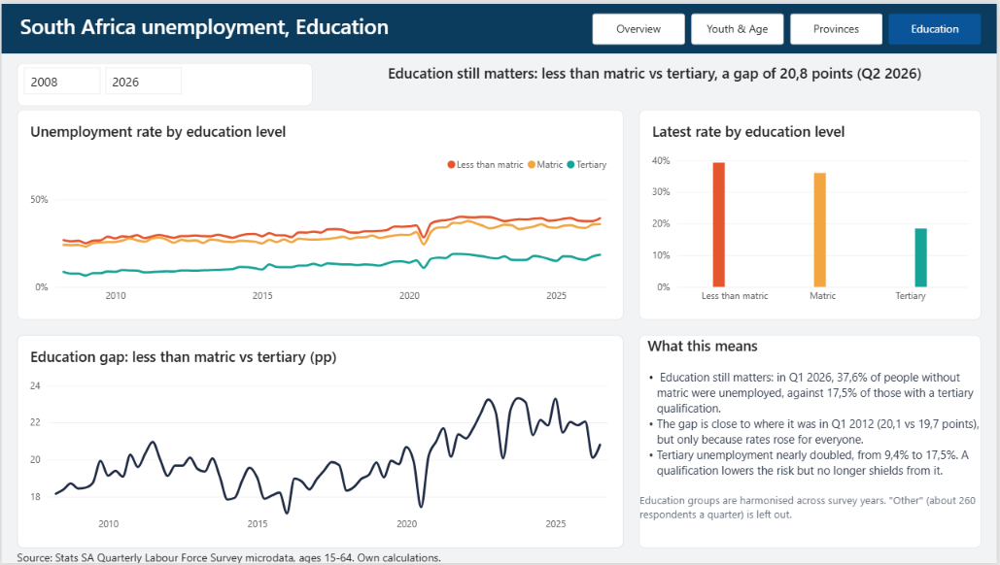

# South Africa Unemployment, 2008 to 2026

An end-to-end analysis of unemployment in South Africa built from Stats SA's raw Quarterly Labour Force Survey (QLFS) microdata, using **pandas** to turn the survey into weighted rates and **Power BI** to model and present them.

This is the second version of the project. [Version 1](https://github.com/Kharendwenegota/sa-unemployment-analysis) used annual World Bank figures; this version reproduces Stats SA's own quarterly numbers from person-level survey records and adds breakdowns by age, province and education.



## Questions the dashboard answers

1. How has unemployment moved since 2008, and how did the 2008-09 crisis and COVID show up?
2. Who is hit hardest: youth or adults?
3. Which provinces are worst?
4. Does education protect against unemployment?

## Key findings

- **Unemployment has not recovered from the 2008 crisis.** The national rate was 21.5% in Q4 2008, its lowest point in the series, and has stayed above that ever since. It peaked at 35.3% in Q4 2021 and was 33.6% in Q2 2026.
- **COVID shows up with a delay.** The rate fell to 23.3% in Q2 2020 because lockdowns stopped many people from looking for work (the official definition only counts people who are searching), then jumped to its peak by Q4 2021.
- **Youth are far worse off.** In Q1 2026, 60.9% of people aged 15-24 in the labour force were unemployed, against 32.7% nationally. The broader 15-34 youth rate was 47.4% in Q2 2026.
- **Province matters a lot.** In Q1 2026 the rate ranged from 19.6% in the Western Cape to 44.6% in the Eastern Cape.
- **Education lowers the risk but is no longer a shield.** In Q1 2026, 37.6% of people with less than matric were unemployed, against 17.5% of those with a tertiary qualification. The gap is about 20 points, roughly where it was in 2012, but tertiary unemployment has nearly doubled over that time (9.4% in Q1 2012).

## Dashboard pages

| Page | What it shows |
|---|---|
| Overview | KPI cards, national rate over time, annual change |
| Youth & Age | Rates by age band, youth vs adult gap |
| Provinces | Latest rate by province, province-by-year heatmap, sample-size warning |
| Education | Rates by education level, education gap over time |





## Method

- **Data:** Stats SA QLFS microdata, one file per quarter, 2008 Q1 to 2026 Q2 (74 quarters), downloaded from Stats SA's ISIbalo portal.
- **Population:** people aged 15 to 64 in the labour force (employed or unemployed), using Stats SA's official unemployment definition.
- **Weighting:** every respondent carries a survey weight. Counts and rates are weighted, so they describe the population and not just the sample.
- **Processing (pandas):** for each quarter, weighted employed and unemployed counts are calculated for the whole country and for province, age band, gender, education, province × age band and age band × education. Results are saved as one tidy table, `qlfs_all.csv`.
- **Rates are always recomputed from counts** (unemployed ÷ employed + unemployed), never averaged, because averaging rates gives wrong answers.
- **Power BI model:** three fact tables (national, province × age, age × education) and four dimension tables (date, province, age, education). Every relationship is one-to-many from a dimension to a fact table. Measures are written in DAX.

### How the numbers were checked

- The national rate matches Stats SA's published figure in all 9 quarters I checked against (2019 Q1 and Q4, 2020 Q1, 2025 Q1 to Q4, 2026 Q1 and Q2).
- For Q1 2026, all 9 provincial rates, all 5 age-band rates and the less-than-matric and graduate rates match the published figures.
- The Q2 2026 youth (15-34) rate of 47.4% is reproduced from the saved counts.
- Employed and unemployed counts for Q1 2026 match the published totals (16.75 million and 8.14 million).

## Limitations

- These are survey estimates and carry sampling error. Small groups (for example, young people in the Northern Cape) rest on a few hundred respondents, and cells with fewer than 150 respondents are flagged. The 150 threshold is my own rule of thumb, not a Stats SA standard.
- Stats SA revised the questionnaire in Q3 2025, so comparisons across that date should be made with care.
- Stats SA re-benchmarks its survey weights from time to time, so counts of people are less comparable across the whole period than rates are.
- Education is grouped into four groups (less than matric, matric, tertiary, other) so the series is consistent across years. The raw education coding was renumbered in 2012 and 2016. I checked that group shares and rates move smoothly across those dates, but I did not confirm the early-year labels against Stats SA's documentation. The small "Other" group is left out of the charts.
- The Q2 2020 dip reflects lockdown job-search rules, not an improvement in the labour market.
- The analysis describes patterns. It does not show what causes them.

## Repository structure

```
sa-unemployment-powerbi/
├── data/
│   ├── raw/microdata/           # Stats SA zips (not committed)
│   └── processed/
│       └── qlfs_all.csv         # the table Power BI loads
├── notebooks/
│   └── 01_build_dataset.ipynb   # downloads, processes and combines the quarters
├── powerbi/
│   └── sa_unemployment.pbix
├── docs/images/                 # dashboard screenshots
├── requirements.txt
└── README.md
```

## Reproduce it

1. Clone the repo and create an environment:
   ```
   python -m venv .venv
   .venv\Scripts\activate
   pip install -r requirements.txt
   ```
2. Open `notebooks/01_build_dataset.ipynb` and run it from top to bottom. It downloads the QLFS zips from Stats SA. If a download is refused, save that quarter's zip by hand from the [ISIbalo QLFS pages](https://www.statssa.gov.za/?page_id=16408) into `data/raw/microdata/` and run the cell again.
3. Open `powerbi/sa_unemployment.pbix`. If you rebuilt the data, refresh it.

You can also skip steps 1 and 2: `data/processed/qlfs_all.csv` is included, so the Power BI file works as it is.

## Source

Statistics South Africa, Quarterly Labour Force Survey. Own calculations. The raw microdata is not included in this repository; download it from Stats SA.
